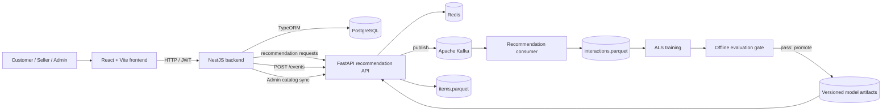

<div align="center">

# MarketNest

### A Multi-Vendor E-Commerce Platform with an Integrated Recommendation System

[](https://react.dev/)
[](https://vite.dev/)
[](https://www.typescriptlang.org/)
[](https://nestjs.com/)
[](https://www.postgresql.org/)
[](https://typeorm.io/)
[](https://fastapi.tiangolo.com/)
[](https://kafka.apache.org/)
[](https://redis.io/)
[](https://www.docker.com/)

</div>

## Overview

MarketNest is a full-stack, multi-vendor marketplace. It combines a React storefront and role-specific management experiences with a NestJS commerce API, PostgreSQL persistence, and a separately deployable FastAPI recommendation engine.

Customers can browse and search the public catalog, visit shops, manage a wishlist and cart, complete checkout, track or cancel eligible orders, confirm delivery, submit reviews, and discover personalized or similar products. Sellers can register and manage a shop, products and inventory, process orders, inspect sales statistics, and reply to reviews. Administrators manage users, shops, categories, product approvals, discounts, shipping configuration and marketplace activity, and can synchronize the live catalog with the recommendation service.

The NestJS backend remains the source of truth for identity, catalog visibility, inventory, pricing and transactions. The recommendation service ranks candidate product IDs; the backend then hydrates and validates those products before returning them to the frontend.

## Key Features

### Customer

- Customer registration, JWT authentication and profile management
- Public product browsing, search, category pages and shop pages
- Product details, stock visibility, product reviews and seller replies
- Wishlist and quantity-aware cart management
- Partial cart checkout, shipping calculation, discounts and payment selection
- Grouped order history, order details, eligible cancellation and delivery confirmation
- Review creation and editing for eligible purchased products
- Personalized recommendations and similar-product discovery

### Seller

- Seller registration, profile and shop lifecycle management
- Product creation, editing, resubmission and inventory updates
- Order processing from confirmation through shipping and completion
- Revenue, product and order statistics
- Review management with seller replies

### Admin

- User inspection, activation and deactivation
- Shop approval, rejection, suspension and reactivation
- Product approval and rejection, including bulk approval operations
- Category, discount and shipping-fee configuration
- Marketplace order monitoring and statistics
- Manual recommendation catalog synchronization

### Recommendation System

- Authenticated personalized recommendations
- Public similar-product recommendations
- Hybrid ranking with implicit ALS, content similarity and trending signals
- Cold-start handling for users with limited or no interaction history
- Kafka-backed event ingestion with local buffering when the broker is unavailable
- Redis response caching and Prometheus-compatible metrics
- Parquet-based catalog and interaction datasets
- Offline evaluation gate before model promotion
- NestJS database fallbacks when the recommendation provider is unavailable

## System Architecture

The browser communicates only with the NestJS API. It does not call FastAPI directly. NestJS owns authentication and commerce policy, while FastAPI provides ranking and similarity candidates.



### Core application flow

```text
React Frontend -> NestJS Backend -> PostgreSQL
React Frontend -> NestJS Backend -> FastAPI Recommendation Engine
```

### Behavior event pipeline

```text
User Behavior
  -> NestJS persistence
  -> FastAPI POST /events
  -> Kafka user-events topic
  -> recommendation consumer
  -> interactions.parquet
  -> model training
  -> offline evaluation gate
  -> model promotion
  -> Recommendation API
```

Behavior persistence is authoritative in NestJS. Publishing to the recommendation provider is best effort, so a temporary provider outage does not undo the commerce action that produced the event.

### Catalog pipeline

```text
PostgreSQL product data
  -> NestJS Admin catalog sync
  -> FastAPI PUT /catalog
  -> items.parquet
```

### Recommendation retrieval

```text
FastAPI ranked item IDs
  -> NestJS batch hydration
  -> commerce eligibility filtering
  -> frontend-ready product response
```

## Technology Stack

| Area | Technologies |
| --- | --- |
| Frontend | React 19, React Router, Vite 8, TypeScript 6, Axios, CSS |
| Backend | NestJS 12, TypeORM, JWT/Passport, class-validator, class-transformer, Axios, RxJS |
| Database | PostgreSQL with versioned TypeORM migrations |
| Recommendation engine | Python 3.11, FastAPI, pandas, PyArrow/Parquet, implicit ALS, scikit-learn TF-IDF, MLflow |
| Messaging and cache | Apache Kafka 3.8, Redis 7 |
| Testing and quality | Vitest, Supertest, ESLint, Oxlint, Pytest |
| DevOps and tooling | Docker, Docker Compose, GitHub Actions |

## Repository Structure

```text
MarketNest/
├── .github/
│   └── workflows/
│       └── recsys.yml              # Recommendation CI and quality-gate smoke test
├── backend/
│   ├── src/
│   │   ├── common/                 # Guards, decorators, enums and shared interfaces
│   │   ├── configs/                # Application, JWT and database configuration
│   │   ├── database/migrations/    # TypeORM schema migrations
│   │   └── modules/                # Commerce and recommendation integration modules
│   ├── test/
│   ├── .env.example
│   └── package.json
├── frontend/
│   ├── src/
│   │   ├── api/                    # NestJS API clients
│   │   ├── components/             # Reusable interface components
│   │   ├── context/                # Authentication state
│   │   ├── layouts/                # Customer, Seller and Admin layouts
│   │   ├── pages/                  # Role-specific screens
│   │   ├── routes/                 # Protected-route handling
│   │   └── types/                  # Frontend contracts
│   ├── .env.example
│   └── package.json
├── recommendation/
│   ├── app/                        # FastAPI, ranking, storage, training and evaluation logic
│   ├── data/                       # Parquet datasets and event buffers
│   ├── docs/                       # Recommendation-specific design notes
│   ├── models/                     # Versioned ALS models and evaluation reports
│   ├── scripts/                    # Topic, consumer, seed, train and evaluation commands
│   ├── tests/
│   ├── Dockerfile
│   ├── docker-compose.yml
│   └── requirements.txt
└── README.md
```

## Domain Model

The PostgreSQL schema is represented by these primary TypeORM entities:

- **Identity:** `User`, `Customer`, `Seller`, `Admin`
- **Marketplace:** `Shop`, `Category`, `Product`, `Inventory`
- **Shopping:** `Cart`, `CartItem`, `Wishlist`, `WishlistItem`
- **Orders:** `OrderGroup`, `Order`, `OrderItem`, `Payment`
- **Engagement:** `Review`, `UserBehavior`
- **Configuration:** `Discount`, `ShippingConfig`

## Recommendation System

### Personalized recommendations

`GET /recommendations` is available to authenticated customers through NestJS. The backend resolves the customer profile, asks FastAPI for more candidates than the requested display limit, batch-loads the corresponding products, preserves provider ranking, and returns public product objects with their score and reason.

If FastAPI is unavailable or produces no eligible candidates, NestJS returns the newest eligible products with the `database_fallback` strategy. The storefront therefore remains usable while the recommendation service is offline.

### Similar products

`GET /recommendations/similar/:productId` is public. FastAPI uses content similarity to find related catalog items. NestJS excludes the source product and applies the same commerce checks as personalized recommendations. Its provider-outage fallback returns eligible products from the same category using `database_same_category_fallback`.

### Behavior signals

The NestJS `BehaviorType` enum contains exactly four signals:

| Backend event | Recommendation event | Produced by |
| --- | --- | --- |
| `VIEW` | `view` | Public product-detail viewing |
| `ADD_CART` | `cart` | Adding a product to the cart |
| `WISHLIST` | `wishlist` | Adding a product to the wishlist |
| `PURCHASE` | `purchase` | Successful order creation |

These events are first recorded in PostgreSQL as `UserBehavior` data. NestJS then publishes the corresponding single-product event to FastAPI.

### Hybrid ranking strategy

The ranking service combines three implemented sources:

1. **Implicit ALS collaborative filtering** learns from weighted user-product interactions.
2. **Content-based similarity** uses TF-IDF catalog representations for item neighbors and user-history signals.
3. **Trending popularity** applies event weights and time decay, and provides the fallback for unknown users.

Users below the configured cold-start threshold use content and trending signals. Users with sufficient distinct consumed products use the full hybrid score. The service suppresses already-consumed products, removes duplicates, filters unavailable catalog items, and limits excessive same-category adjacency.

### Catalog synchronization

An administrator can invoke `POST /admin/recommendation/catalog/sync`. NestJS builds a full recommendation-safe product snapshot and sends it to FastAPI through `PUT /catalog`. The service validates the snapshot and atomically writes `recommendation/data/items.parquet`.

The synchronization endpoint is protected by `JwtAuthGuard`, `RolesGuard` and the `ADMIN` role. It is intentionally not a public catalog-management endpoint.

### Event processing

FastAPI accepts one interaction through `POST /events`, assigns or preserves a request ID, and publishes it to the `user-events` Kafka topic. If Kafka is temporarily unavailable, the API writes the event to its local buffer instead of returning a server error.

The `recommendation-consumer` joins the `recsys-v1` consumer group, deduplicates request IDs, and atomically updates `interactions.parquet`. A dead-letter topic named `user-events-dlq` is also provisioned by the repository bootstrap script.

### Model lifecycle

```text
Interaction snapshot
  -> train versioned ALS model
  -> evaluate against the popularity baseline
  -> require the offline quality gate to pass
  -> update current_version.txt
  -> invalidate relevant cached results
```

The evaluation command reports Precision@K, Recall@K, NDCG@K and MAP@K. Promotion requires the hybrid NDCG to exceed the baseline by the configured `0.02` margin and requires cold-start coverage. A failed evaluation exits with code `3`; the active model pointer is left unchanged.

### Commerce filtering

FastAPI ranks candidates, but NestJS decides what may be shown. A recommended item is returned only when:

- `Product.status` is `APPROVED`
- `Shop.status` is `ACTIVE`
- `Category.status` is `ACTIVE`
- an `Inventory` record exists
- `inventory.quantity > inventory.reservedQuantity`

This keeps marketplace rules centralized in the commerce backend.

## Installation and Setup

### Prerequisites

- [Node.js](https://nodejs.org/) with npm
- [PostgreSQL](https://www.postgresql.org/)
- [Docker Desktop](https://www.docker.com/products/docker-desktop/) with Docker Compose
- Bash through Git Bash, WSL or a Unix-like shell for the provided recommendation scripts
- Python 3.11 only when running the recommendation service outside Docker

> The repository pins the recommendation CI environment to Python 3.11. Docker is the recommended local runtime for FastAPI, Kafka, Redis and the consumer.

### 1. Clone the repository

```bash
git clone https://github.com/Doancoso-phenikaa/ecommerce-recommendation-system.git
cd ecommerce-recommendation-system
```

### 2. Configure PostgreSQL

Create an empty PostgreSQL database and a user with permission to manage its schema. Keep the connection values available for the backend environment file. Schema synchronization is disabled; migrations must be run explicitly.

### 3. Backend setup

```bash
cd backend
npm install
cp .env.example .env
```

Configure `backend/.env`:

```dotenv
DB_HOST=localhost
DB_PORT=5432
DB_USERNAME=postgres
DB_PASSWORD=your_password
DB_NAME=marketnest
DB_SSL=false
DB_SSL_REJECT_UNAUTHORIZED=true
DB_SSL_CA_PATH=

JWT_ACCESS_SECRET=replace_with_a_strong_access_secret
JWT_ACCESS_EXPIRES_IN=15m
JWT_REFRESH_SECRET=replace_with_a_strong_refresh_secret
JWT_REFRESH_EXPIRES_IN=7d

RECOMMENDATION_SERVICE_URL=http://localhost:8000
RECOMMENDATION_SERVICE_TIMEOUT_MS=5000
```

Apply the existing migrations and start the API:

```bash
npm run migration:run
npm run start:dev
```

The backend listens on `http://localhost:3000` by default and permits the local Vite origin at `http://localhost:5173`.

### 4. Recommendation stack

From the repository root, start Kafka and Redis first:

```bash
docker compose -f recommendation/docker-compose.yml up -d kafka redis
bash recommendation/scripts/bootstrap_topics.sh
```

Build and start FastAPI and the Kafka consumer:

```bash
docker compose -f recommendation/docker-compose.yml up -d --build recommendation-api recommendation-consumer
```

Verify the stack:

```bash
docker compose -f recommendation/docker-compose.yml ps
curl http://localhost:8000/health
```

The bootstrap script is required because Kafka topic auto-creation is disabled. It idempotently creates `user-events` and `user-events-dlq`.

To stop the recommendation stack without deleting its named volumes:

```bash
docker compose -f recommendation/docker-compose.yml down
```

### 5. Frontend setup

Open a separate terminal:

```bash
cd frontend
npm install
cp .env.example .env
npm run dev
```

The default frontend environment is:

```dotenv
VITE_API_URL=http://localhost:3000
```

Open `http://localhost:5173`.

### Windows environment-file copies

When using PowerShell instead of Bash, replace the `cp` commands with:

```powershell
Copy-Item backend/.env.example backend/.env
Copy-Item frontend/.env.example frontend/.env
```

### Optional native Python setup

Docker avoids platform-specific scientific Python and Kafka setup. If the recommendation service must run natively, the repository supports Python 3.11:

```bash
python -m venv recommendation/.venv
source recommendation/.venv/bin/activate
python -m pip install -r recommendation/requirements.txt
```

Set `PYTHONPATH` to the repository root and provide at least `REDIS_URL` and `MODEL_DIR`. Kafka defaults to `localhost:9092` and the topic defaults to `user-events`.

```bash
export PYTHONPATH=.
export REDIS_URL=redis://localhost:6379/0
export MODEL_DIR="$PWD/recommendation/models"
uvicorn recommendation.app.main:app --host 0.0.0.0 --port 8000
```

Run the consumer in another terminal with the same environment:

```bash
python recommendation/scripts/consume.py
```

### Service endpoints

| Service | Local address | Purpose |
| --- | --- | --- |
| React frontend | `http://localhost:5173` | Customer, Seller and Admin interfaces |
| NestJS backend | `http://localhost:3000` | Authentication and commerce API |
| FastAPI recommendation service | `http://localhost:8000` | Ranking, events, catalog sync and health |
| Kafka | `localhost:9092` | Behavior event stream |
| Redis | `localhost:6379` | Recommendation cache |

## Recommendation Operations

### Synchronize the real product catalog

After signing in as an administrator, trigger the protected NestJS endpoint with the issued access token:

```bash
curl -X POST http://localhost:3000/admin/recommendation/catalog/sync \
  -H "Authorization: Bearer <ADMIN_ACCESS_TOKEN>"
```

### Seed, train and evaluate

The commands used by CI are run from the repository root:

```bash
export PYTHONPATH=.
python recommendation/scripts/seed.py
python recommendation/scripts/train.py --version local --no-pointer
python recommendation/scripts/evaluate.py --version local
```

`--no-pointer` prevents an unevaluated model from becoming active. The evaluation command promotes nothing by itself; the lifecycle script owns gated promotion.

### Gated retraining

Inspect the workflow without mutating the active pointer, cache or log:

```bash
bash recommendation/scripts/retrain.sh --dry-run
```

Run the complete drain, train, evaluate and promotion workflow:

```bash
bash recommendation/scripts/retrain.sh
```

Use `--no-consumer-restart` only when an external supervisor owns the consumer process.

## API Highlights

This is a selected integration map rather than a complete API specification.

| Method and path | Access | Purpose |
| --- | --- | --- |
| `POST /auth/register/customer` | Public | Register a customer account |
| `POST /auth/register/seller` | Public | Register a seller account |
| `POST /auth/login` | Public | Issue access and refresh tokens |
| `GET /products` | Public | Browse and filter eligible products |
| `GET /products/:productId` | Public | Read a public product detail |
| `GET /shops` | Public | List active shops |
| `GET /shops/:shopId` | Public | Read a public shop page payload |
| `POST /checkout/preview` | Customer | Preview selected cart items and totals |
| `POST /checkout` | Customer | Confirm checkout and create orders |
| `GET /recommendations` | Customer | Get personalized, hydrated products |
| `GET /recommendations/similar/:productId` | Public | Get similar, hydrated products |
| `POST /admin/recommendation/catalog/sync` | Admin | Push a full catalog snapshot to FastAPI |

FastAPI also exposes `POST /events`, `PUT /catalog`, `GET /recommendations/{user_id}`, `GET /similar/{item_id}`, `GET /health` and `GET /metrics` for server-to-server integration and observability.

## Quality Checks

### Frontend

```bash
cd frontend
npm run lint
npm run build
```

### Backend

```bash
cd backend
npm run lint
npm run test
npm run build
```

### Recommendation service

From the repository root with Python dependencies installed:

```bash
PYTHONPATH=. python -m pytest recommendation/tests -q -m "not integration"
```

The GitHub Actions workflow also performs a `seed -> train -> evaluate` smoke test and verifies that the baseline-only evaluation fails with the expected exit code `3`.

## Troubleshooting

### Recommendation provider connection warnings

Warnings containing `ECONNREFUSED 127.0.0.1:8000` or `ECONNREFUSED ::1:8000` mean that NestJS cannot reach FastAPI at `RECOMMENDATION_SERVICE_URL`. Check Docker Desktop and the service state:

```bash
docker compose -f recommendation/docker-compose.yml ps
curl http://localhost:8000/health
```

Commerce remains available because NestJS uses database-backed recommendation fallbacks and event publication is best effort.

### Kafka topics are missing

Kafka auto-creation is deliberately disabled. Run:

```bash
bash recommendation/scripts/bootstrap_topics.sh
```

### Database schema errors

Confirm that the PostgreSQL values in `backend/.env` are correct, then apply migrations:

```bash
cd backend
npm run migration:run
```

Do not enable TypeORM `synchronize`; the application and CLI configurations both intentionally set it to `false`.

## Security and Configuration Notes

- Never commit populated `.env` files or production secrets.
- Use distinct, high-entropy JWT access and refresh secrets.
- Keep `DB_SSL=true` and configure certificate verification when required by the deployed PostgreSQL provider.
- The local Docker Compose topology is intended for development and evaluation; production sizing, secrets, persistence and Kafka replication require separate deployment configuration.
- FastAPI is an internal ranking provider. Route browser traffic through NestJS so authorization and commerce rules remain enforced.

## Contributors

MarketNest is developed and maintained by the project team. Repository contributions can be reviewed on the [GitHub contributors page](https://github.com/Doancoso-phenikaa/ecommerce-recommendation-system/graphs/contributors).

To contribute:

1. Create a focused branch from the appropriate development branch.
2. Keep changes within one feature or fix.
3. Run the relevant lint, build and test commands.
4. Open a pull request that explains behavior changes and verification performed.

## License

This repository does not currently include a root license file, and the backend package is marked `UNLICENSED`. No permission to use, modify or redistribute the project should be inferred until the maintainers add an explicit license.
